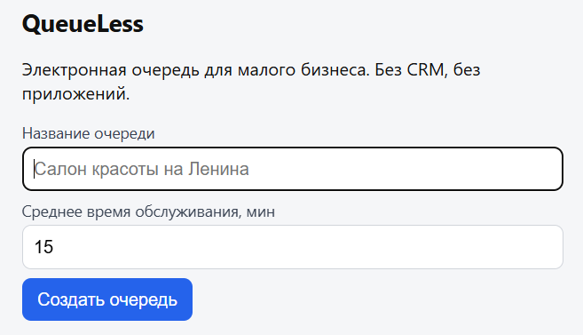
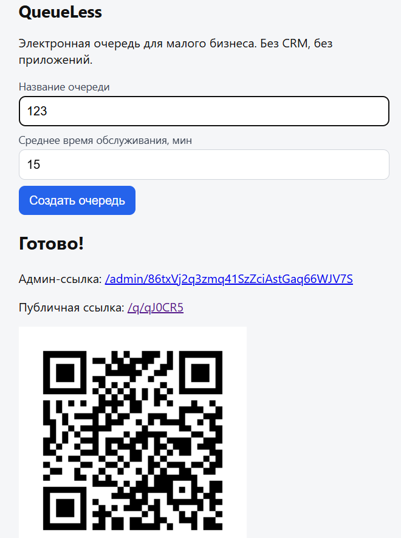
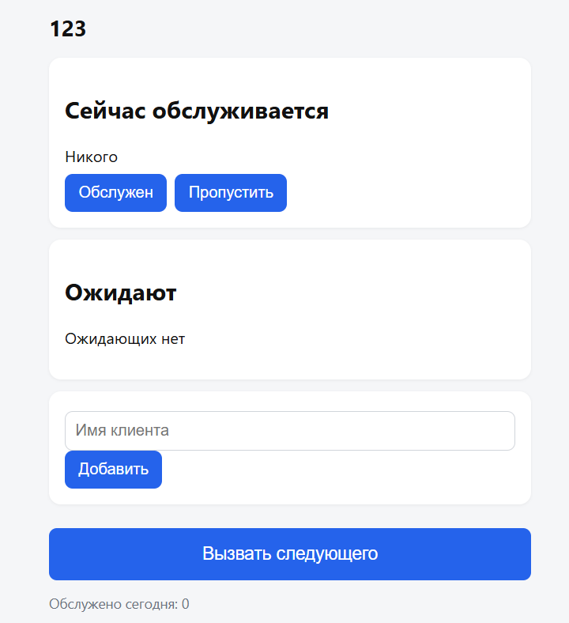
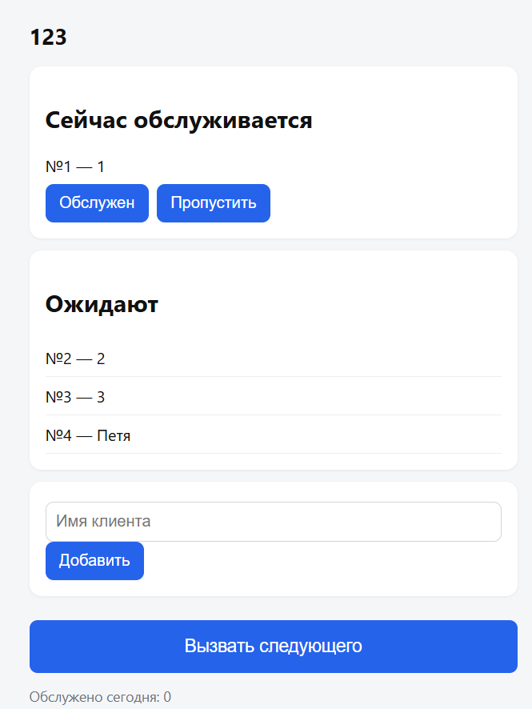
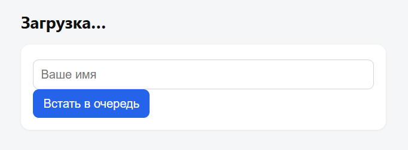
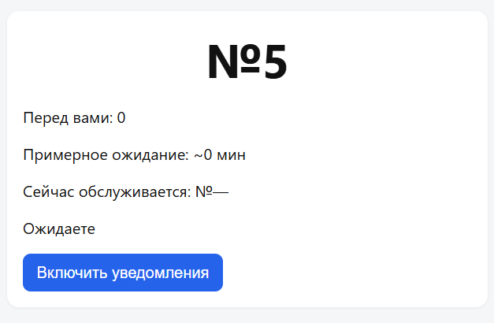

# ИНСТРУКЦИЯ ПОЛЬЗОВАТЕЛЯ QueueLess (пошаговое руководство)

## 0. ВВЕДЕНИЕ

* **Название проекта:** QueueLess — умная электронная очередь для малого бизнеса.
* **Ссылка на работающий MVP:** http://72.56.95.229/
* **Исходный код:** https://github.com/sofa523/queueless
* **Для кого этот продукт:** для владельцев и администраторов небольших точек обслуживания (салоны красоты, шиномонтажи, ремонтные мастерские, сервисные центры), где клиенты вынуждены ждать своей очереди.
* **Что он делает:** позволяет клиенту встать в электронную очередь по QR-коду со смартфона и видеть свое примерное время ожидания, а администратору — управлять очередью в один клик без бумажных журналов и сложных CRM.
* **Сколько времени займёт знакомство:** 3–5 минут до первого результата. Регистрация не требуется ни владельцу, ни клиенту.

---

## 1. ПЕРВЫЙ ВХОД В ПРОДУКТ

* **Как попасть в продукт:** http://72.56.95.229/
* **Что нужно сделать на старте:**
  1. Владельцу бизнеса не нужна регистрация. На главном экране введите **название вашей точки** (например, «Салон красоты на Ленина»).
  2. Укажите **среднее время обслуживания** одного клиента в минутах (по умолчанию 15).
  3. Нажмите **«Создать очередь»**.
  4. Система мгновенно сгенерирует **Админ-ссылку** (для вас), **Публичную ссылку** (для клиентов) и **QR-код** (для печати).
* **Что пользователь увидит первым:** главный экран с формой создания очереди и кратким описанием. После создания — блок «Готово!», где можно скопировать ссылки и скачать QR-код.

---

## 2. ОСНОВНАЯ ФУНКЦИЯ №1: УПРАВЛЕНИЕ ОЧЕРЕДЬЮ (АДМИН-ПАНЕЛЬ)

* **Название функции:** управление очередью в реальном времени (добавление, вызов следующего, пропуск, отметка «обслужен»).
* **Зачем она нужна пользователю:** закрывает критическую боль бизнеса — необходимость постоянно вести бумажный журнал и отвечать на вопросы «когда моя очередь?». Администратор просто нажимает одну кнопку.
* **Пошаговая инструкция:**
  1. Скопируйте **Админ-ссылку** из блока «Готово!» и откройте её.
  2. Вы увидите панель управления: блок «Сейчас обслуживается», список «Ожидают», кнопку **«Вызвать следующего»** и статистику.
  3. Когда клиент обслужен, нажмите **«Обслужен»**. Счетчик «Обслужено сегодня» увеличится.
  4. Чтобы вызвать следующего, нажмите большую кнопку **«Вызвать следующего»**. Текущий клиент уйдет в историю, а первый из ожидающих получит уведомление.
  5. Если клиент не пришел, нажмите **«Пропустить»**. Если нужно добавить человека лично (например, по телефону), введите имя в форму и нажмите **«Добавить»**.
* **Пример входных данных:** нажатие кнопки «Вызвать следующего» при наличии ожидающих.
* **Пример результата:** статус клиента меняется на «Ваша очередь!», а в админке он перемещается в блок «Сейчас обслуживается».

| Админ-панель (пустая)      | Админ-панель (с клиентами) |
|----------------------------|----------------------------|
|  |  |

---

## 3. ОСНОВНАЯ ФУНКЦИЯ №2: КЛИЕНТСКАЯ СТРАНИЦА И ЭЛЕКТРОННАЯ ОЧЕРЕДЬ

* **Название функции:** вход в очередь по QR-коду, отображение номера, позиции и примерного времени ожидания.
* **Зачем она нужна:** клиент больше не привязан к физическому месту. Он может отойти по делам и вернуться ровно к началу обслуживания.
* **Пошаговая инструкция:**
  1. Клиент сканирует QR-код с камеры смартфона или открывает Публичную ссылку.
  2. На экране появляется название вашей точки и поле для ввода имени.
  3. Клиент вводит имя (например, «Иван») и нажимает **«Встать в очередь»**.
  4. Система присваивает номер и мгновенно показывает: «Перед вами: N человек» и «Примерное ожидание: ~M минут».
  5. Страница автоматически обновляется каждые 5 секунд, пересчитывая время ожидания.
* **Пример входных данных:** имя «Иван».
* **Пример результата:** клиент видит большой номер `№8`, позицию `3` и время ожидания `~60 мин`.

| Ввод имени клиентом | Статус клиента в очереди |
|---|--|
|  |  |

---

## 4. ОСНОВНАЯ ФУНКЦИЯ №3: АВТОМАТИЧЕСКИЕ УВЕДОМЛЕНИЯ

* **Название функции:** Web Push-уведомления и визуальное оповещение о наступлении очереди.
* **Зачем она нужна:** завершает цикл. Клиент может спокойно пить кофе в соседнем кафе, пока ему на телефон не придет пуш-уведомление «Ваша очередь!».
* **Пошаговая инструкция:**
  1. На клиентской странице (где отображается номер очереди) нажмите кнопку **«Включить уведомления»**.
  2. Браузер запросит разрешение — нажмите «Разрешить».
  3. Когда администратор в панели управления нажмет «Вызвать следующего», на телефон клиента мгновенно придет push-уведомление.
  4. В самом окне браузера статус также изменится на **«Ваша очередь! Подойдите к стойке»**.
  5. *(Если браузер клиента не поддерживает Push — например, старый iPhone, система автоматически использует резервный метод: страница будет обновляться сама каждые 5 секунд).*
* **Пример входных данных:** нажатие кнопки «Включить уведомления» и действие администратора «Вызвать следующего».
* **Пример результата:** всплывающее окно на смартфоне клиента с текстом «Ваша очередь!».

---

## 5. ЧТО ДЕЛАТЬ, ЕСЛИ ЧТО-ТО ПОШЛО НЕ ТАК

* **Ошибка №1:** «Неверный токен» (в админке).
  → **Что делать:** проверьте, что вы скопировали админ-ссылку полностью (она состоит из 32 символов после `/admin/`).
* **Ошибка №2:** «Ваш браузер не поддерживает push-уведомления».
  → **Что делать:** не критично. Очередь продолжит работать, а статус на экране будет обновляться автоматически каждые 5 секунд.
* **Ошибка №3:** «Очередь не найдена» (при сканировании QR).
  → **Что делать:** убедитесь, что владелец бизнеса не удалил очередь и сервер запущен. Проверьте интернет-соединение.
* **Ошибка №4:** «Сервис временно недоступен» (500).
  → **Что делать:** перезагрузите страницу через 5 секунд. Если ошибка повторяется — сообщите администратору системы.

---

## 6. ЧАСТЫЕ ВОПРОСЫ (FAQ)

* **Нужно ли клиенту скачивать приложение?**
  Нет. Клиент открывает веб-страницу по QR-коду в обычном браузере. Web Push-уведомления работают прямо в браузере без установки софта.
* **Нужна ли регистрация для владельца бизнеса?**
  Нет. Чтобы создать очередь, достаточно ввести название точки и время обслуживания. Админ-доступ защищен секретной ссылкой.
* **Что будет, если клиент закроет вкладку?**
  Его билет сохранится в системе. Если он снова откроет ту же ссылку, система вспомнит его и покажет актуальную позицию. Но push-уведомление прийти не сможет, пока он не откроет сайт снова.
* **Можно ли создать несколько очередей?**
  В текущей MVP-версии архитектура заточена под одну простую очередь (например, один филиал). Поддержка нескольких точек и сотрудников — следующий этап развития проекта.
* **Сколько хранятся данные?**
  Имена клиентов и билеты со статусами «обслужен» или «пропущен» автоматически удаляются через 24 часа. Система не собирает и не хранит номера телефонов или IP-адреса клиентов.
* **Работает ли сайт круглосуточно?**
  Да. Работают непрерывно.
